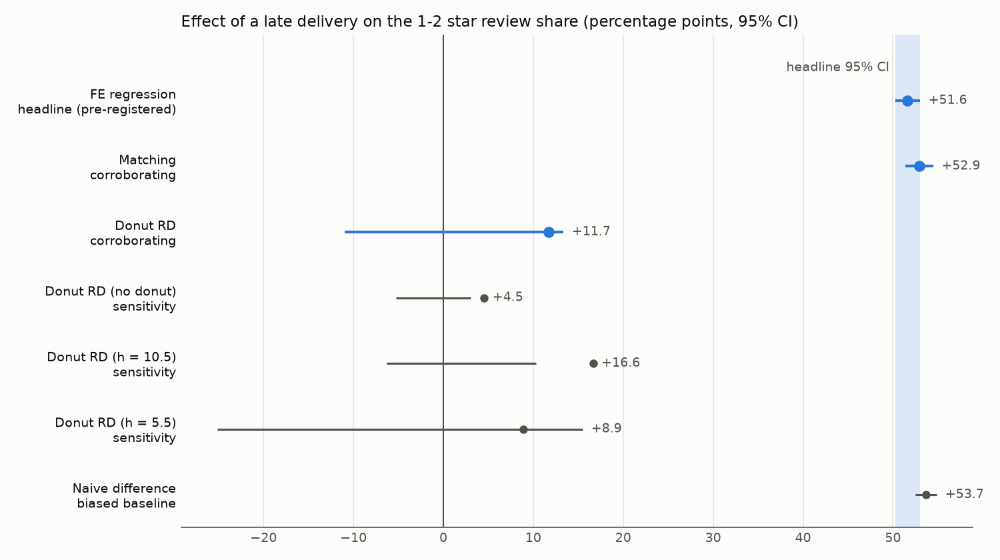
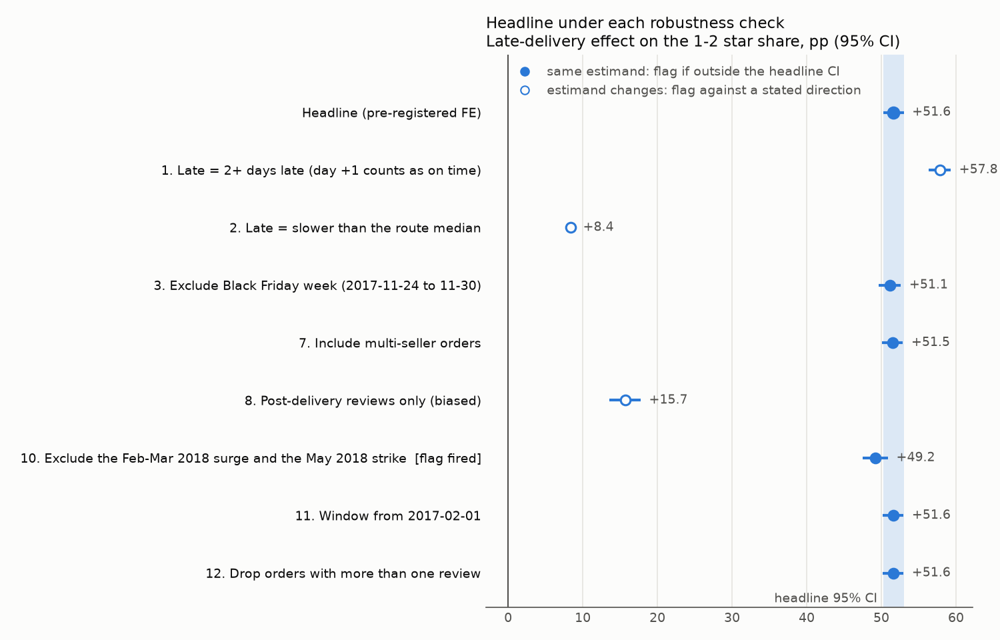
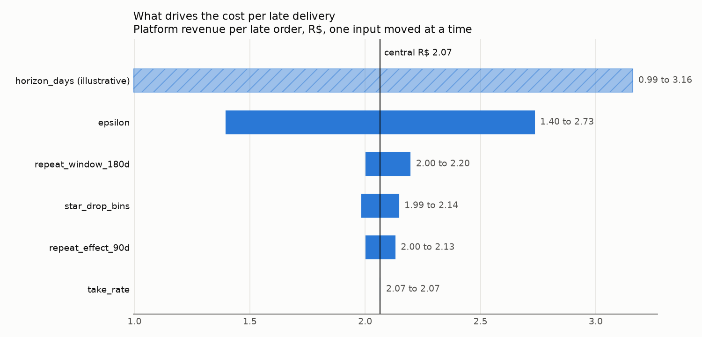

# What does a late delivery actually cost?

## Question and answer

Leadership's question is whether faster logistics pays for itself. The useful unit is platform revenue lost per late delivery, not the value of the whole basket. The central estimate is **R$2.07 [US$0.62]**, with bounds of R$0.60–R$4.42 [US$0.18–US$1.33]. Almost all of this rests on outside estimates of how lower seller ratings affect later sales. The directly measured repeat-purchase component is R$0.06 [US$0.02], with no statistically detectable repeat-purchase effect.

The preferred review estimate is **51.6 more unhappy reviews per 100 late orders**, conditional on the identification assumptions below. Its probability difference is 0.516, with a 95% confidence interval of [0.502, 0.530]. Matching corroborates it; the comparison around the promised date does not identify a reliable local effect. The evidence supports a large association consistent with harm from broken promises, not an experimental guarantee of savings.

The decision rule is to fund improvements where the cost per late delivery avoided is below the estimated revenue saved, while treating the range as assumption-dependent. Make promises accurate before buying speed, but test longer promises before rollout because their effect on checkout purchases is absent from these data. The [stakeholder memo](memo.md) gives that recommendation without the technical machinery. This write-up explains what would have to be true for it to work.

Details: [money reading, ADR-0014](../engineering/decisions/ADR-0014-phase4-money-reading.md); [cost results](../../outputs/money.md); [review estimates](../../outputs/fe.md).

## Limitations

**Observational identification comes first.** Late orders differ from on-time orders. The headline adjusts for recorded characteristics and seller and purchase-week fixed effects, but the data contain no carrier identifier. Time-varying seller quality, fulfillment failures or unrecorded customer expectations could still affect both delivery and reviews. Matching uses the same observed information, so its agreement is not independent protection against omitted variables. Narrow confidence intervals measure sampling uncertainty under the model; they do not include bias from an invalid comparison.

**The disruption periods matter.** Removing the February–March 2018 surge and orders exposed to the May 2018 truckers' strike lowers the review estimate to 0.492, outside the headline interval. This is a pre-specified fragility flag, not a result to discard. The corresponding money scenario is R$2.15 [US$0.64], which remains inside the headline bounds. Stability of the money reading does not erase instability of the review effect.

**The promised-date comparison is not like-for-like.** Orders just past the cutoff had promise windows 3.44 days longer, with robust interval [2.37, 6.88]. Bunching before the promised date supplies another warning. The regression discontinuity therefore cannot establish the causal effect of crossing that date. It remains visible as a diagnostic rather than being removed because it disagrees.

**The review outcome includes waiting.** Olist's survey can arrive after the promised date while an order is still in transit. Conditioning on reviews written after delivery changes the sample in a way lateness itself causes. That subset's effect is 0.157, versus 0.516 overall, but is deliberately labeled biased. The headline may not transfer to platforms that survey only after delivery. Missing reviews are also not observed customer opinions.

**The money estimate is mostly a scenario.** External rating-to-sales effects come from other settings; whether Olist's channels expose seller ratings is unverified. Review persistence is illustrative, support contacts are unmeasured, and commission revenue is gross of any channel fees. The delivered single-seller sample leaves out cancellations and never-delivered orders. Calling that sample conservative describes its scope, not a proven lower bound on all marketplace harm. These limits should travel with the headline whenever it is quoted.

Details: [robustness reading, ADR-0012](../engineering/decisions/ADR-0012-phase3-robustness-reading.md); [robustness results](../../outputs/robustness.md); [money assumptions and caveats](../../outputs/money.md).

## Data and sample

The source is Olist's public Brazilian e-commerce dataset. The pipeline keeps **99,441 orders** in an order-level table and assigns an exclusion reason rather than silently deleting rows. Raw CSVs are committed unchanged with checksums. Orders join to customers, items, sellers, products, category translations and aggregated locations. Reviews are deduplicated by the latest answer, preserving a single outcome per order. Joining a many-row table must not multiply the order grain.

The headline window is purchases from 2017-01-01 through 2018-08-31. An order must be delivered, have a customer delivery timestamp and items, and belong to a single seller. These rules leave **94,931 headline orders**, including 6,518 late orders (6.87%). Exclusion precedence matters: an order failing several rules appears in the first applicable exclusion category, so counts reconcile to the raw total. The complete waterfall is in the diagnostics, not repeated here.

Review availability and estimator support further distinguish samples. The primary model starts with 94,302 reviewed headline orders, drops 526 singleton observations in fixed-effect pruning, and estimates on 93,776 observations across 2,396 seller clusters. Those are different denominators, not inconsistent totals. Repeat-purchase analyses use eligible first orders instead, while matching has its own separation and overlap exclusions.

Location joins use zip-prefix medians rather than treating repeated geolocation records as separate places. Analysis-time distance values above 5,000 km are treated as missing and filled under the fixed rule, with a missingness control retained. These transforms are shared across estimators. Raw locations and the full built table remain unchanged, preserving the distinction between data cleaning, sample definition and analysis preparation.

Details: [sample decision, ADR-0005](../engineering/decisions/ADR-0005-headline-sample.md); [diagnostics and exclusions](../../outputs/diagnostics.md); [primary-model sample echo](../../outputs/fe.md).

## Definitions: JC 1 and JC 5

**JC 1—late against the promise, not merely slow.** `days_late` is the difference between actual and promised calendar dates. Delivery on the promised date is on time; delivery after it is late. The promise timestamp has no within-day information, so the running variable is discrete. `delivery_days` instead measures elapsed time from purchase to delivery. `promised_days` records the offered calendar-day window. These variables support different questions and must not be substituted for each other.

The review headline is the share of 1-2 star reviews. A probability difference can be expressed as extra unhappy reviews per fixed-size group; it is not a proportional increase in the baseline rate. Mean stars and the star distribution are secondary outcomes. The model grid separates total lateness, days-late bins, lateness holding speed fixed, delivery-time bins among on-time orders, and continuous speed. This keeps the operational distinction between avoiding a broken promise and shortening an otherwise on-time delivery visible.

**JC 5—follow people after they experience delivery.** `customer_id` identifies an order-specific customer record; repeat purchase uses `customer_unique_id`. A repeat must be placed after the first observed order's delivery, not while that order is in transit. This excludes split-session orders from being mistaken for a reaction to delivery quality. The primary window is 90 days; 180 days is a check. Eligibility requires the full follow-up window inside the observation period, so longer windows use fewer first orders.

| Window (days) | Eligible first orders | Regression observations | Effect (pp) | 95% CI (pp) |
|---|---|---|---|---|
| 90 | 72,130 | 71,692 | -0.240 | [-0.488, 0.007] |
| 180 | 51,704 | 51,362 | -0.258 | [-0.729, 0.214] |

Both intervals include zero; neither window establishes a detectable change in repeat buying. Before estimation, the 90-day pooled repeat rate was 1.15%, with a best-case minimum detectable effect of 0.43 percentage points. That rarity explains why a small point estimate should not be sold as precise customer-lifetime damage. The money model keeps a bounded repeat-loss channel rather than inventing an unobserved lifetime multiplier. It also does not interpret a non-significant estimate as proof that customers never respond.

Details: [late definition, ADR-0003](../engineering/decisions/ADR-0003-estimand-and-late-definition.md); [outcomes and repeat window, ADR-0004](../engineering/decisions/ADR-0004-outcomes-and-repeat-purchase.md); [outcome models](../../outputs/fe.md); [pre-estimation power](../../outputs/diagnostics.md).

## Method ladder: JC 3

**JC 3 fixes the hierarchy before comparing results.** The naive late-versus-on-time difference is a biased baseline. The pre-registered headline is a linear probability model with seller and purchase-week fixed effects. Propensity-score matching and a donut regression discontinuity are corroborating methods, not competing headline candidates selected after seeing significance. The grid contains 25 pre-registered models spanning the planned outcomes and treatment forms.

The headline controls for category, customer state, transformed item price and freight, item count, distance, missing distance and the length of the promised window. Seller fixed effects absorb stable seller differences; purchase-week effects absorb common weekly shocks. Inference clusters by seller because orders from a seller need not have independent errors. Linear probability coefficients retain a direct probability-difference interpretation; the specification is used for its pre-registered comparison rather than as a model of bounded individual predictions.

| Method | Role | Effect (share) | 95% CI |
|---|---|---|---|
| Naive difference | biased baseline | 0.537 | [0.525, 0.549] |
| FE regression | headline (pre-registered) | 0.516 | [0.502, 0.530] |
| Donut RD | corroborating | 0.117 | [-0.110, 0.134] |
| Matching | corroborating | 0.529 | [0.513, 0.545] |

Effects in this table are differences in shares, not percentages of revenue. The RD reports its conventional point estimate with a robust bias-corrected interval; other rows use their recorded clustered intervals. The rows also target different populations, which is why agreement is informative but averaging their estimates is not justified.

Matching estimates a propensity model from observed controls, excluding seller fixed effects, then matches within purchase week on the logit score with replacement and a fixed caliper. Levels that perfectly predict treatment are removed under the recorded separation rule before fitting; non-convergence is an error, not permission to accept a failed model. It matches 6,356 late orders and leaves 10 unmatched. Maximum post-match absolute standardized imbalance is 0.0511. Its standard errors do not incorporate propensity-estimation uncertainty.



Details: [pre-registration, ADR-0007](../engineering/decisions/ADR-0007-pre-registration.md); [specifications, ADR-0008](../engineering/decisions/ADR-0008-phase2-implementation-choices.md); [separation rule, ADR-0009](../engineering/decisions/ADR-0009-matching-separation.md); [method ladder](../../outputs/ladder.md).

## Reconciling disagreement: JC 4

**JC 4 forbids moving the goalposts.** The pre-registered convergence rule asks whether a corroborating point estimate falls inside the headline's 95% interval. The headline is labeled fragile under that rule only if both corroborating methods diverge in the same direction. Matching converges and the donut RD diverges below, so that particular fragility flag does not fire. This narrow rule is not a blanket claim that all assumptions survived; later robustness checks have their own flags.

The RD asks about a local jump around the promised date. The headline averages a lateness effect across the late-order population after adjustment. Days-late bins show that harm grows beyond mild delays, so these are not identical estimands. Bunching in delivery dates led to dropping days 0 and +1. At the main bandwidth of 7.5 days, the fit must bridge that gap rather than observe a dense continuous threshold experiment.

Its conventional estimate is 0.117; the bias-corrected estimate is 0.012. The robust interval [-0.110, 0.134] includes zero. The difference between point estimates warns about extrapolation and curvature. Robust intervals belong to the bias-corrected procedure, so a conventional estimate need not sit at their center. Sensitivity specifications remain in the full output rather than being filtered to the most favorable window.

Most importantly, the continuity check finds unlike promise windows on either side. That failure means the RD cannot isolate the promise itself, regardless of whether its number looks compatible with a preferred story. The headline therefore rests on the fixed-effects comparison, with matching as corroboration. Matching's lack of seller fixed effects can explain some difference from the headline, but their closeness cannot identify how much omitted-variable bias remains. The money calculation uses the pre-specified total-effect bins, not a post hoc average or the more convenient local estimate.

Details: [reconciliation, ADR-0010](../engineering/decisions/ADR-0010-phase2-reconciliation.md); [continuity interpretation, ADR-0012](../engineering/decisions/ADR-0012-phase3-robustness-reading.md); [RD specifications](../../outputs/rd.md); [matching diagnostics](../../outputs/matching.md).

## Robustness and confounding: JC 2

**JC 2 asks which comparisons might still mislead.** The pipeline runs 12 pre-registered checks and records 2 fired flags. Sample checks compare their point estimates with the original headline interval. Alternative estimands have directional rules; diagnostic checks test their own assumptions. A failed continuity check is not equivalent to a sample check moving the headline, and a changed treatment is not expected to reproduce the original coefficient.

| Check | Sample change | Effect (share) | 95% CI | Flag |
|---|---|---|---|---|
| 3 | Exclude Black Friday week (2017-11-24 to 11-30) | 0.511 | [0.497, 0.526] | no |
| 7 | Include multi-seller orders | 0.515 | [0.501, 0.529] | no |
| 10 | Exclude the Feb-Mar 2018 surge and the May 2018 strike | 0.492 | [0.475, 0.509] | yes |

These selected sample checks illustrate stable sample variations and the important exception. Excluding the surge and strike produces 0.492, with interval [0.475, 0.509]. The remaining late orders are less late. A calculation using the original bin effects explains 57.1% of the observed decline through that changed mix. It is labeled exploratory because it was not a pre-registered estimator; its arithmetic is now reproduced by code. The unexplained remainder prevents the mix story from becoming a complete causal explanation.

The sensitivity analysis asks how strong an omitted confounder would have to be to remove the headline under its algebraic assumptions. The robustness value is 33.9% of the residual variation in both treatment and outcome. Customer state, the strongest observed benchmark, explains 1.70% of residual treatment variation and 0.13% of residual outcome variation. This comparison makes the assumption concrete; it does not prove that an unrecorded carrier or fulfillment shock is weaker than the benchmark.

The post-delivery-only result remains a mechanism check, not a replacement headline, because conditioning on survey timing introduces selection. Alternative lateness definitions likewise answer different questions. The complete output retains placebo estimates, continuity tests, benchmark bounds, repeat-window results and each sample's observation counts. Keeping their distinct roles visible is more informative than reporting a single count of checks passed and calling the analysis robust.



Details: [check rules, ADR-0011](../engineering/decisions/ADR-0011-phase3-implementation-choices.md); [reading the flags, ADR-0012](../engineering/decisions/ADR-0012-phase3-robustness-reading.md); [all robustness results](../../outputs/robustness.md).

## From effects to money: JC 6

**JC 6 separates measurement from assumptions.** The target is platform commission revenue per late headline order. Lost order value is not platform revenue. The assumed commission rate is 20%; item-price revenue excludes freight. Currency conversion uses R$3.33054 per US dollar, the mean of 20 monthly exchange-rate observations recorded with their source. Each assumed input is sourced or explicitly illustrative; measured inputs are references, not copied numbers in the assumptions file.

The repeat channel combines the bounded repeat-probability loss with the observed value of repeat purchases and commission. Its central contribution is R$0.06 [US$0.02], and its upper end is R$0.13 [US$0.04]. The interval's lack of a detectable repeat effect remains part of the interpretation; pricing a bound is not discovering a precise revenue loss.

The rating channel combines bin-specific star drops, an external sales response, dilution by each seller's visible review count and the seller's later sales exposed during the assumed review lifetime. It is calculated at seller exposure level rather than multiplying platform averages. The repeat channel accounts for only 3.0% of the central total. The remainder therefore depends on assumptions about a mechanism not directly identified here, including whether buyers see seller ratings on Olist's channels.

The review lifetime is the largest driver. Holding the other central choices fixed, assumed durations of 30, 90 and 180 days produce R$0.99, R$2.07 and R$3.16 per late order. Longer horizons also change which reviews have complete follow-up. The headline range stacks low-cost or high-cost input endpoints; it is not a confidence interval or a probability that the true cost lies inside it.

Support is outside that range. Assuming 1 additional contact per late order adds R$6.32 [US$1.90] centrally, but contact incidence is unmeasured. Measure support contacts and review persistence before promoting either scenario into a firm budget. At this dataset's volume, the annual illustration is R$8,078 [US$2,425], not a claim about Olist's full business.

The operating recommendation remains break-even plus promise-first. A broken promise's review effect is equivalent to about 105 extra delivery days in the holding-speed model, a ratio of point estimates rather than a tested policy trade-off. Test longer promised dates against checkout conversion before rolling them out. Avoid paying for speed merely because the modeled loss sounds large; require evidence that the proposed change actually prevents late deliveries at an acceptable marginal cost.



Details: [money framing, ADR-0006](../engineering/decisions/ADR-0006-money-framing.md); [formulas and inputs, ADR-0013](../engineering/decisions/ADR-0013-phase4-implementation-choices.md); [money reading, ADR-0014](../engineering/decisions/ADR-0014-phase4-money-reading.md); [full cost results](../../outputs/money.md); [versioned assumptions](../../assumptions.toml).

## Reproduce and audit

From a clean clone, install the locked environment and rebuild through the staleness gate:

```bash
uv sync && make check-outputs
```

The Makefile verifies raw checksums before building the order table, runs tests, produces diagnostics and estimators, then renders the reports. Every one of the 99,441 raw orders remains accounted for. Processed intermediate data stay ignored; reader-facing outputs are committed. JSON and Markdown drift causes the guard to fail and name changed paths. PNGs are regenerated and committed but excluded from the byte-staleness comparison, so a passing guard alone is not proof that figures were visually reviewed or are portable byte for byte across machines.

Edit prose in `docs/report/*.template.md`, not the generated documents. `make report` refreshes its estimator prerequisites before rendering; running the renderer module alone uses existing outputs. Placeholders resolve dictionary paths or derived values, with list selections checked for unique matches. Bad placeholders, unused derived values, broken relative links or an oversized memo stop validation before rendered documents are replaced. Statistics belong in source outputs or derived calculations, never hand-typed into prose.

Audit from the claim to its placeholder, JSON field and producing module, then read the governing ADR for the choice behind it. The decision log records options, reasons and falsification tests, not just successful results. Reproducibility establishes the computation; identification and external validity still require the judgments discussed above.

Details: [stack and raw data, ADR-0002](../engineering/decisions/ADR-0002-stack-and-raw-data.md); [rendering rules, ADR-0015](../engineering/decisions/ADR-0015-phase5-communication-choices.md); [workflow](../engineering/dev-workflow.md); [Makefile](../../Makefile); [rebuildable method results](../../outputs/ladder.md).
